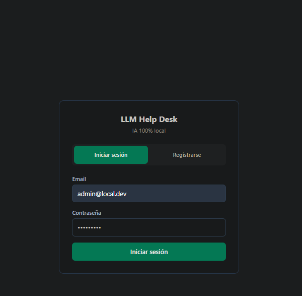
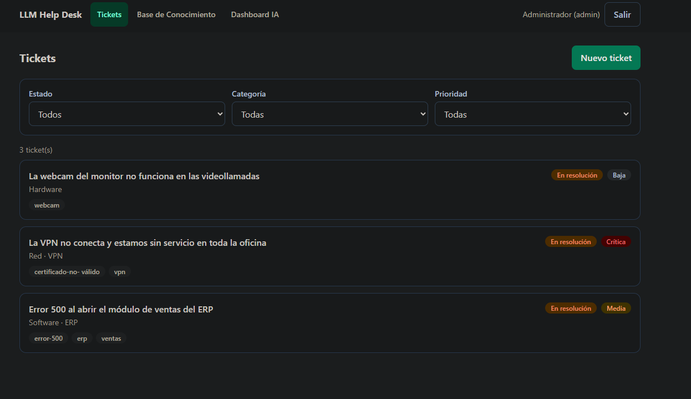
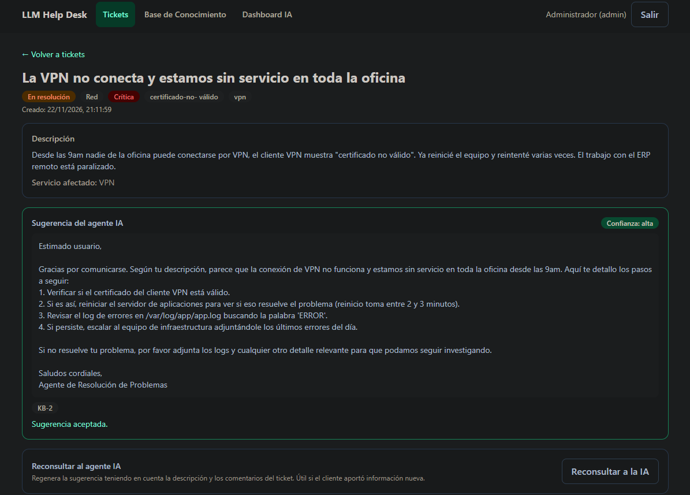
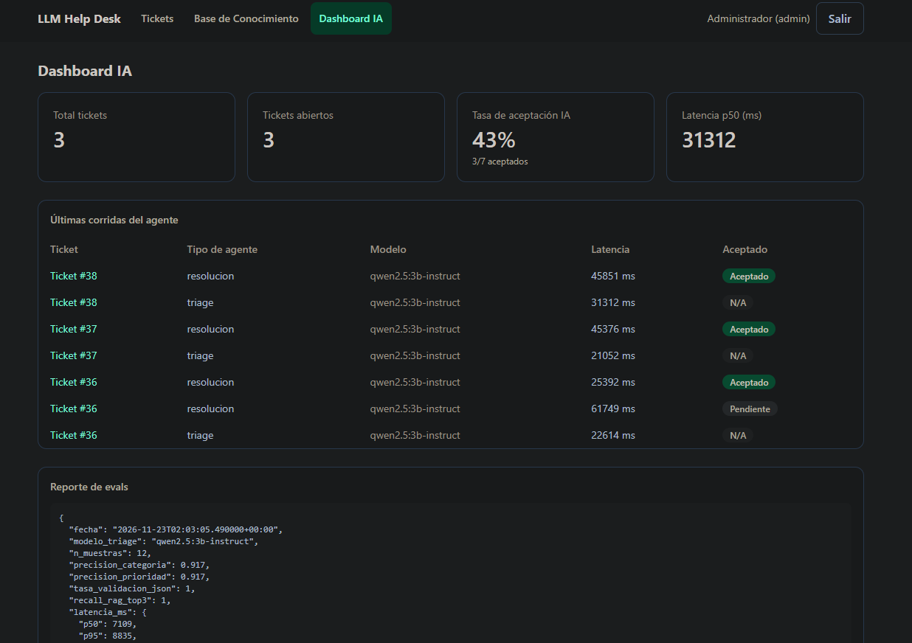
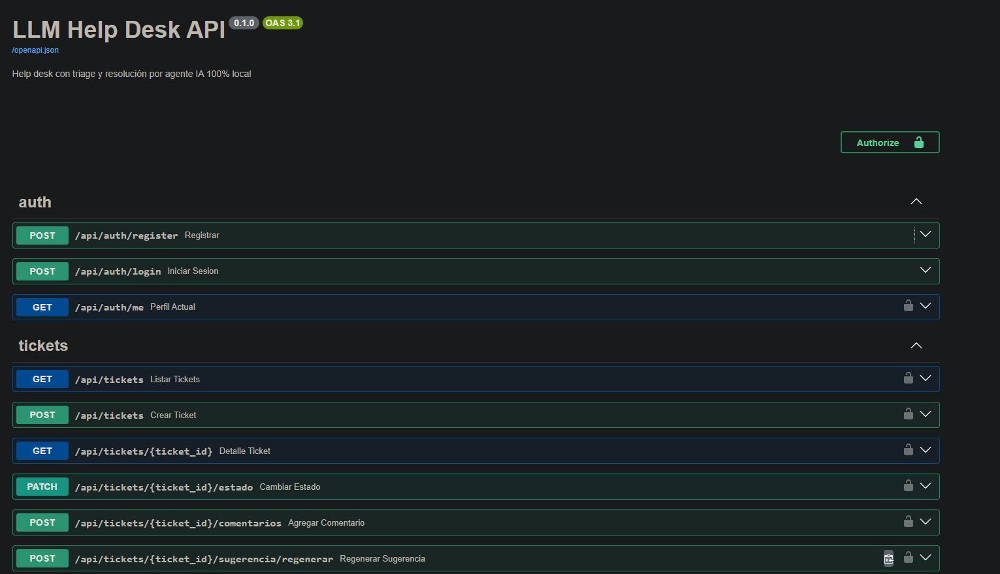
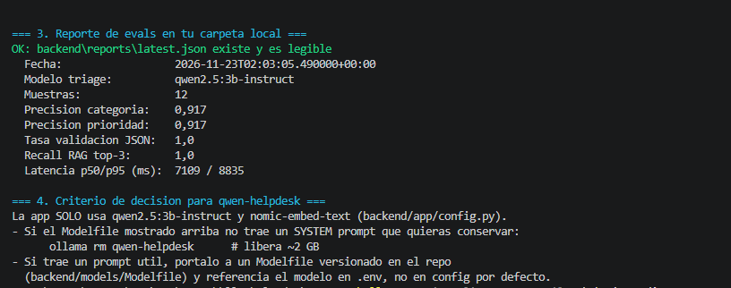
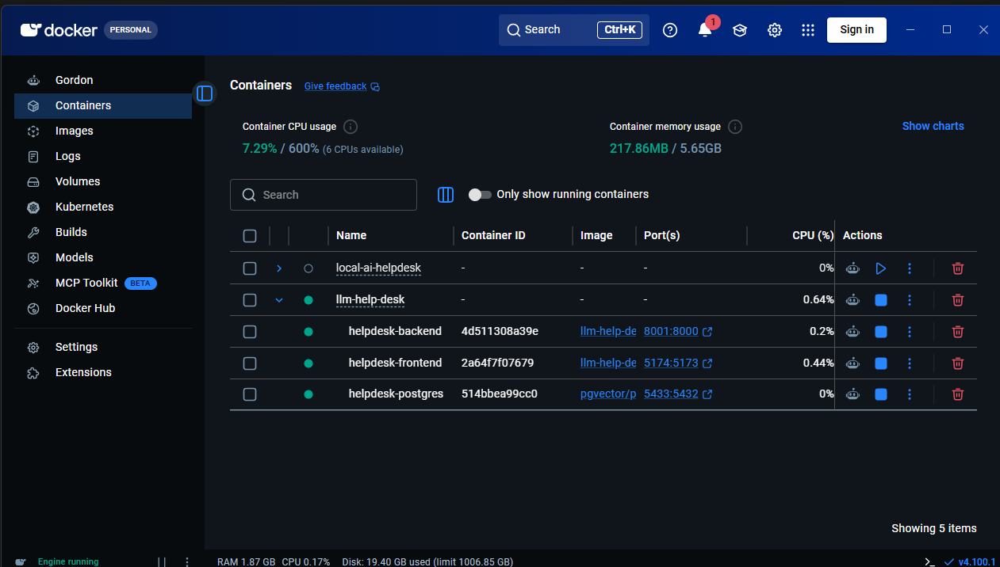

# LLM Help Desk


Plataforma de help desk de TI con **triage y primera respuesta automatizados por un agente IA 100% local** (Qwen vía Ollama). Sin datos que salgan de tu máquina, con validación determinista de salidas del LLM (cero alucinaciones por diseño) y con human-in-the-loop: el agente IA sugiere, un humano decide.

## Qué lo diferencia

- **El LLM decide, el código determinista ejecuta**: el modelo solo devuelve JSON validado con Pydantic; si falla, el ticket cae en cola manual (fallback graceful).
- **Reglas de negocio sobre el modelo**: si el texto indica caída total / facturación / producción, la prioridad se fuerza a `critica` sin importar lo que diga el LLM.
- **Anti-alucinación en código**: la sugerencia del agente cita fuentes `[KB-XXX]`; si el modelo inventa una fuente que no estaba en el contexto recuperado, la sugerencia se rechaza.
- **Guardias contra modos de fallo de modelos 3B**: `repeat_penalty`, límite de tokens y un detector determinista de salidas repetitivas (`textguard.py`) — si el modelo entra en bucle, la salida se rechaza y se reintenta; el intento queda auditado.
- **Todo auditable y medible**: cada decisión del agente queda en `agent_runs` (modelo, prompt, latencia, tokens, aceptación humana) y la suite de evals genera reportes reproducibles.
- **Elección del modelo con datos**: el script de benchmark compara modelos de Qwen sobre el dataset dorado, en tu máquina.

## Capturas

**Login** — autenticación JWT con tres roles: cliente, agente y admin.



**Tickets** — máquina de estados (nuevo → triage IA → en resolución → cerrado), con filtros por estado, categoría y prioridad. La prioridad `critica` fue forzada por regla determinista, no por el LLM.



**Detalle del ticket con sugerencia IA** — borrador de resolución con citas a la KB `[KB-XXX]`, nivel de confianza y botón de reconsulta con el contexto de los comentarios. El humano acepta, edita o rechaza (human-in-the-loop).



**Dashboard IA** — métricas operativas (tasa de aceptación humana, latencia p50 del pipeline) y auditoría de `agent_runs` (modelo, agente, latencia, decisión humana), más el reporte de evals integrado.



**API (Swagger)** — OpenAPI auto-documentado; los candados indican endpoints protegidos por JWT/RBAC.



**Evals en tu carpeta local** — salida de `check_pendientes.ps1`: el reporte `backend/reports/latest.json` queda visible y persistente fuera del contenedor, con las métricas del run (recall@3 = 1.0).



**El stack corriendo** — los tres contenedores (frontend, backend, postgres) más Ollama nativo en el host, todo bajo ~6 GB de RAM.



## Arquitectura

```
React + Vite (TypeScript)  ──►  FastAPI  ──►  PostgreSQL + pgvector
                                      │
                                      ├──►  Ollama: qwen2.5:3b-instruct (triage y resolución)
                                      └──►  Ollama: nomic-embed-text (RAG)
```

Pipeline de un ticket nuevo:

1. El usuario crea el ticket → el orquestador corre en segundo plano.
2. **Agente de triage** (Qwen): categoría, prioridad, servicio, etiquetas y justificación en JSON validado. Las reglas deterministas pueden sobreescribir la prioridad.
3. **Agente de resolución** (RAG): recupera los top-k fragmentos de la KB con pgvector y redacta un borrador con citas `[KB-XXX]`.
4. El **agente humano** ve el ticket ya clasificado, acepta/edita/rechaza el borrador, y su decisión alimenta las métricas de aceptación.

## Stack

| Capa | Tecnología |
|---|---|
| Frontend | React 18, Vite, TypeScript, Tailwind CSS, React Router |
| Backend | Python, FastAPI, SQLAlchemy 2.0, JWT (python-jose) |
| BD | PostgreSQL 16 + pgvector (búsqueda semántica) |
| IA | Ollama — `qwen2.5:3b-instruct` (triage/resolución) + `nomic-embed-text` (embeddings) |
| Infra | Docker Compose (postgres, backend, frontend) + Ollama nativo en el host |

## Quickstart

Requisitos: Docker (con Compose) y ~6 GB de RAM libres. Todo el proyecto cabe cómodamente en un equipo de 16 GB.

```bash
# 1. Variables de entorno
cp .env.example .env

# 2. Levantar el stack
make up            # o: docker compose up -d --build

# 3. Descargar los modelos (Ollama corre NATIVO en tu máquina, no en Docker)
ollama pull qwen2.5:3b-instruct   # ~2 GB (triage y resolución)
ollama pull nomic-embed-text      # ~274 MB (embeddings RAG)

# 4. Datos de demostración (usuarios, KB con embeddings, tickets)
make seed

# 5. Verificar el backend
make health        # debe responder {"estado":"ok", ...}
```

- Frontend: http://localhost:5174  (el compose publica el 5174 en el host para no chocar con el 5173)
- API docs (Swagger): http://localhost:8001/docs  (el backend publica el 8001 en el host para no chocar con el 8000)

Usuarios de prueba (creados por el seed):

| Email | Clave | Rol |
|---|---|---|
| admin@local.dev | admin1234 | admin |
| agente1@local.dev | agente1234 | agente |
| cliente1@local.dev | cliente1234 | cliente |

> Ollama corre nativo en el host (mejor para CPU-only: sin la capa de Docker).
> El compose ya deja `OLLAMA_BASE_URL=http://host.docker.internal:11434`.
> Puertos en el host: frontend 5174, backend 8001 (el 5173 y 8000 quedan libres
> para otros proyectos; dentro de la red de Docker no cambia nada).

## Eval del agente — resultados medidos

```bash
make evals         # corre el dataset dorado y genera app/evals/reports/latest.json
make benchmark     # compara modelos de Qwen sobre el dataset dorado, en tu máquina
make limpiar       # borra todos los tickets (conserva usuarios y KB, reinicia IDs)
```

Resultados reproducibles en hardware real (CPU-only, 16 GB RAM, qwen2.5:3b-instruct q4_K_M):

| Métrica | Resultado |
|---|---|
| Precisión de categoría | 91.7% (11/12) |
| Precisión de prioridad | 91.7% (11/12) |
| Tasa de validación JSON | 100% |
| Recall@3 del RAG | **100%** (tras la mejora documentada abajo) |
| Latencia triage p50 / p95 | ~7.1s / ~8.8s |

**Caso de iteración medible (por qué las evals importan):** la primera corrida
midió recall@3 = 0.75. El detalle por muestra del reporte mostró que en tickets
ambiguos ("el correo va lento") la búsqueda semántica cruda recuperaba
fragmentos de artículos de otras categorías. Fix: acotar la búsqueda RAG por la
categoría que ya asignó el triage (con fallback global si no hay resultados).
Re-medición: recall@3 = 1.00 con precisión estable. Baseline → fix → re-medición,
todo reproducible con un comando.

Metas v1 cumplidas: precisión de categoría ≥ 85% · validación JSON ≥ 95% · recall@3 ≥ 90%.
(p50 de triage en esta CPU quedó ~7s; el objetivo de 4s requiere GPU o un modelo más pequeño.)

## Estructura del repo

```
llm-help-desk/
├── docker-compose.yml
├── Makefile
├── LICENSE                       # MIT
├── init_git.ps1                  # inicializa el repo y hace el primer push
├── check_pendientes.ps1          # verifica modelos Ollama y el reporte de evals local
├── docs/                         # capturas de pantalla del README
├── backend/
│   ├── app/
│   │   ├── main.py               # FastAPI + startup (create_all, admin inicial)
│   │   ├── config.py             # configuración por variables de entorno
│   │   ├── models.py             # 6 tablas (users, tickets, events, kb, chunks, agent_runs)
│   │   ├── schemas.py            # Pydantic: API + salidas obligatorias del LLM
│   │   ├── security.py / deps.py # JWT + RBAC (cliente | agente | admin)
│   │   ├── routers/              # auth, tickets, kb, agent, evals
│   │   ├── services/             # ollama_client, rules (reglas deterministas), rag, textguard
│   │   ├── agents/               # triage, resolution, orchestrator, prompts/
│   │   └── evals/                # runner + golden_dataset.jsonl + reports/
│   └── scripts/                  # seed_demo, run_evals, benchmark_modelos, limpiar_tickets
└── frontend/                     # React + Vite + TypeScript + Tailwind
```

## Decisiones de diseño (por qué así)

- **FastAPI en vez de Streamlit**: el producto es multi-usuario con RBAC y una máquina de estados de ticket; Streamlit no escala a eso.
- **Sin CrewAI / LangGraph en v1**: la orquestación es una secuencia de dos pasos con validación y auditoría; hacerlo a mano es más simple, más rápido y demuestra criterio sobre cuándo NO usar un framework.
- **pgvector en vez de ChromaDB**: un solo servicio de BD menos en el stack y misma capacidad para el tamaño de KB de este proyecto.
- **Qwen 2.5 3B cuantizado (q4_K_M)**: equilibrio entre calidad de JSON estructurado y latencia en CPU (~8-12 tok/s); presupuesto total del stack < 6 GB de RAM.
- **Human-in-the-loop obligatorio**: el agente nunca cierra tickets ni aplica estados por sí solo; las acciones de cierre son siempre humanas.

## Arquitectura: monolito modular hoy, microservicios-ready

La v1 es un **monolito modular deliberado**: una sola app FastAPI con dominios delimitados (routers `auth`, `tickets`, `kb`, `agent`, `evals`), backend stateless (JWT, sin sesión pegajosa) y **un único punto de acceso al LLM** (`ollama_client`). Esas tres propiedades son las costuras que hacen trivial una futura separación:

```
Hoy (monolito modular)
┌─────────────────────────────────────────────┐
│                FastAPI (una app)            │
│  auth · tickets · kb · agent · evals        │
│  services: ollama_client · rules · rag      │
│  agents: triage · resolution · orchestrator │
└──────────────────────────┬──────────────────┘
                           ▼
              PostgreSQL+pgvector · Ollama (host)

v2 (corte natural en servicios)
┌──────────────┐   ┌──────────────────┐   ┌────────────────┐
│ tickets-core │   │    ai-gateway    │   │     kb-rag     │
│ CRUD, estados│──►│ ollama_client    │   │ artículos,     │
│ RBAC, eventos│   │ triage,          │◄──│ chunks, pgvector,
│ agent_runs   │   │ resolution,      │   │ búsqueda top-k │
└──────────────┘   │ textguard        │   └────────────────┘
                   └────────┬─────────┘
                            ▼
                    Ollama (escala aparte)
```

Por qué **no** separar en v1: con tráfico de demo y CPU-only, tres contenedores extra son costo operativo sin beneficio, y una sola BD relational ya garantiza la consistencia entre tickets y `agent_runs`. El `ai-gateway` es el primer candidato a extraerse (la inferencia es lo único que escala distinto al CRUD); defender cuándo NO microservificar es parte del criterio arquitectónico del proyecto.

## Roadmap (explícitamente fuera de la v1)

- Separación en servicios: extraer `ai-gateway` (inferencia) de `tickets-core` — ver sección de arquitectura
- Chat en tiempo real (WebSockets) y notificaciones
- Multi-tenant y SLA timers
- Ingesta de KB desde archivos (PDF/Markdown) y email
- Memoria conversacional multi-turno en el agente de resolución
- Fine-tuning del modelo de triage con los tickets reales aceptados

## Licencia

[MIT](LICENSE) — puedes usar, modificar y redistribuir el código con atribución. Los modelos de Qwen tienen su propia licencia (Apache 2.0 en las versiones 2.5 usadas aquí).

## API (resumen)

```
POST /api/auth/register | /api/auth/login        GET /api/auth/me
GET  /api/tickets?estado=&categoria=&prioridad=  POST /api/tickets
GET  /api/tickets/{id}                           PATCH /api/tickets/{id}/estado
POST /api/tickets/{id}/comentarios               POST /api/tickets/{id}/sugerencia/decision
POST /api/tickets/{id}/sugerencia/regenerar      # reconsulta IA con los comentarios del ticket
GET/POST /api/kb/articles                        POST /api/kb/articles/{id}/reingesta
GET  /api/agent/runs                             POST /api/evals/run  ·  GET /api/evals/report
```
